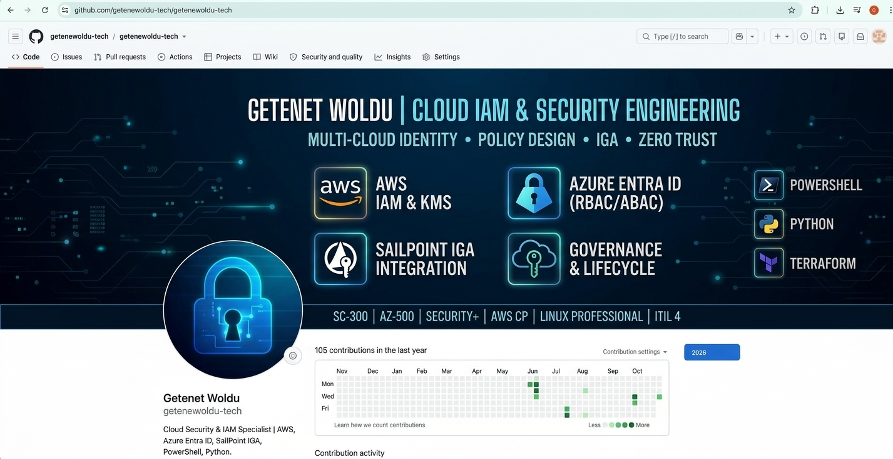

  

# Getenet Woldu
### Cloud Security & Identity Engineering | Multi-Cloud IAM | Identity Governance & Administration

---

## About Me
Cloud and Identity Security Specialist focused on engineering enterprise Identity & Access Management (IAM) systems, least-privilege architecture, and automated identity governance workflows. Hands-on experience across AWS, Microsoft Azure, Microsoft Entra ID, and SailPoint IGA.

- Currently building: Multi-Cloud IAM & Security Engineering Sandbox
- Primary Focus: Directory Federation (SAML/SCIM), RBAC/ABAC Policy Design, Zero Trust Engineering
- Certifications: Azure Security Engineer (AZ-500) | Identity & Access Administrator (SC-300) | AWS Cloud Practitioner | CompTIA Security+ | CompTIA Network+ | CompTIA A+ | Linux Professional | ITIL 4 Foundation

---

## Technical Skillset

| Category | Domain Technologies |
| :--- | :--- |
| **Identity & Governance** | Microsoft Entra ID, SailPoint IGA, SAML 2.0, SCIM, OAuth 2.0 / OIDC, RBAC / ABAC, Privileged Identity Management (PIM) |
| **Cloud Platforms** | Amazon Web Services (AWS IAM, KMS, S3, VPC), Microsoft Azure (Entra ID, Azure Security Center) |
| **Scripting & Automation** | PowerShell, Python, Bash, Shell Scripting |
| **Systems & Infrastructure** | Linux Administration (Ubuntu), macOS Terminal, Virtualization (UTM), Cloud Networking (VPCs, Subnets, Security Groups) |

---

## Featured Lab Repository
- **[Cloud-IAM-Security-LAB](https://github.com/getenewoldu-tech/Cloud-IAM-Security-LAB)**: Production-aligned identity laboratories covering least-privilege policy engineering, Azure Entra ID governance, SailPoint IGA integration, cryptographic controls, and multi-region network segmentation.
